# Sendero screenshot walkthrough

[Return to the briefing](readme.md)

Screenshots supplied for the bonus-track submission, captured on 20 November 2026. The English-interface captures below document the prototype, including empty and no-match states. Synthetic evidence is illustrative. The individual shown is a demonstration identifier; this gallery is not a release of patient-level source exports.

## Select a person

Identifier-based selection and entry into an encounter. The screenshot shows the demonstration list, not the size of the underlying NAVETA cohort.

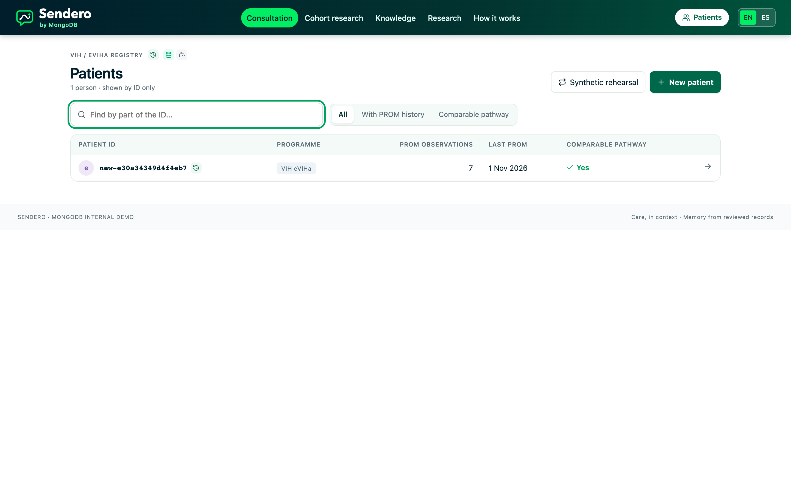

## History and PROM workspace

This capture explicitly has no historical sources loaded and no repeated numeric series. It shows the empty state, not imported longitudinal clinical evidence.

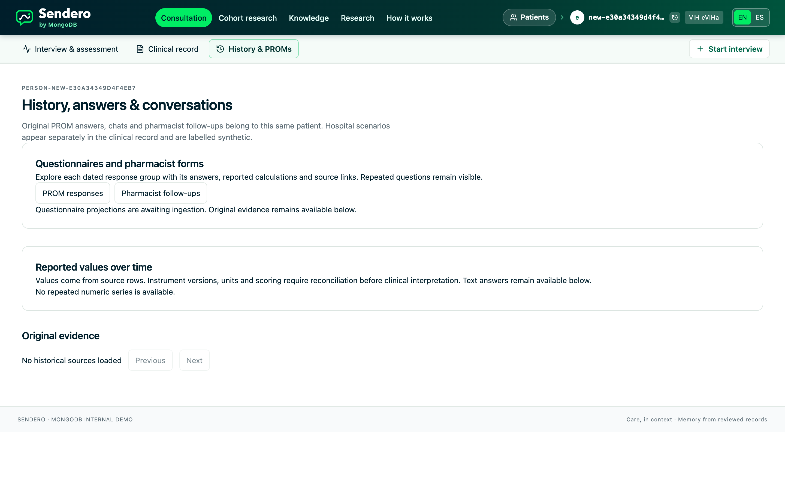

## Target a concern

A broad opening question and answer buttons coexist with access to other assessment topics. Guided mode is optional.

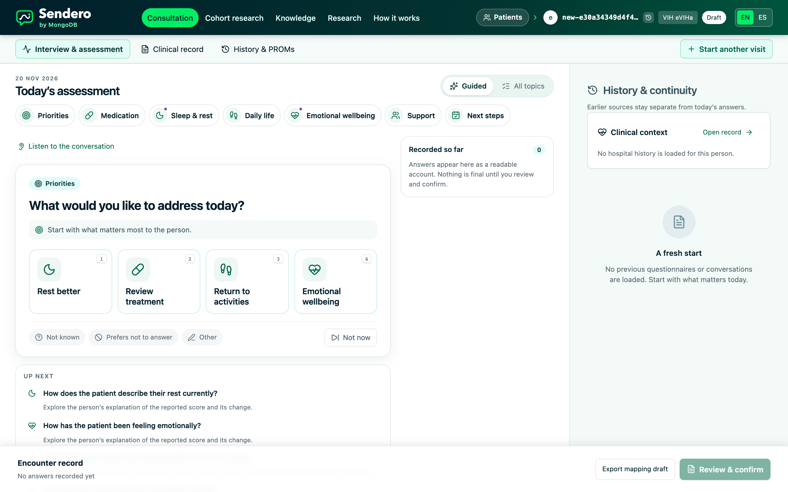

## Relate a concern to evidence

A rest concern is shown beside a synthetic score-history card. Its illustrative values must not be interpreted as validated raw questionnaire item scores.

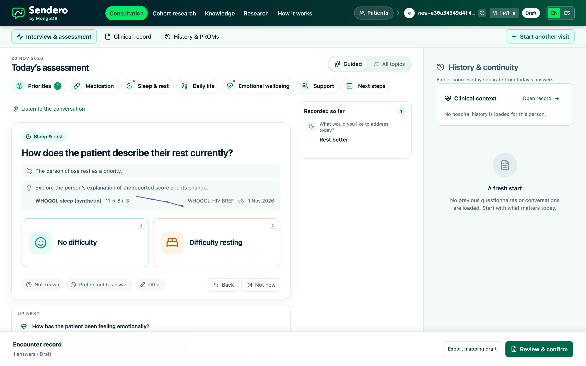

## Refine the description

A sleep difficulty leads to duration and further details while preserving the developing account and the path into the question.

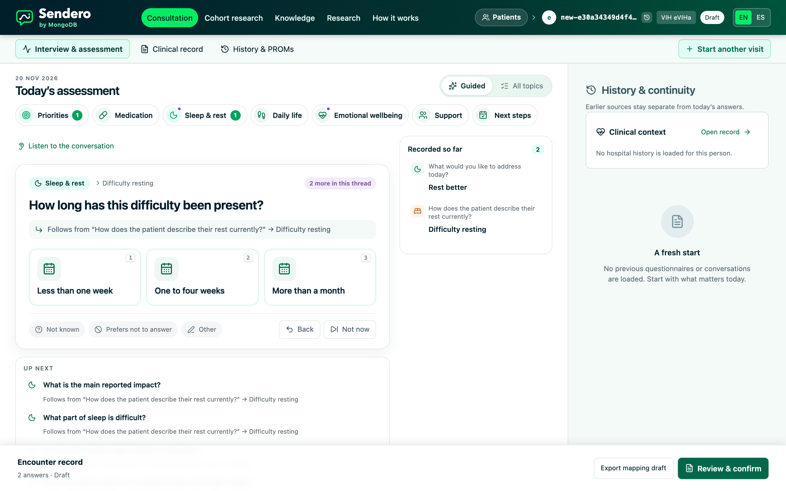

## Offer answers without supplying them

Medication-taking options and descriptive response frequencies are visible. Frequencies describe the displayed aggregate; they are not a probability that this individual will give a particular answer.

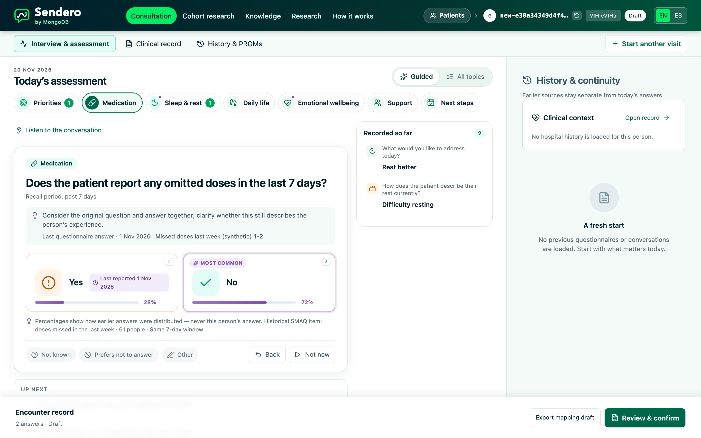

## Target by location

The physical-concern fragment supports body-region selection as another entry point into refinement.

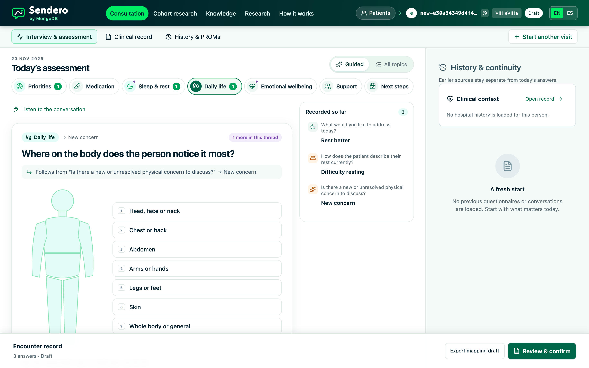

## Confirm the intended account

The professional reviews the narrative and selected answers. The visible mapping-draft label is important: confirming this interview does not certify a native openEHR export.

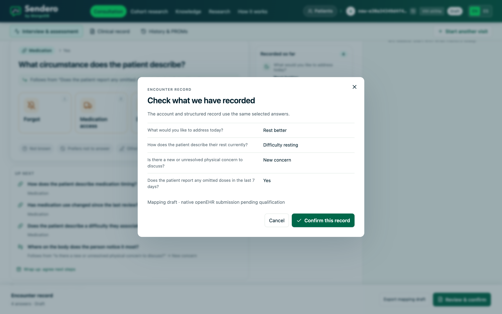

## Keep evidence beside the interview

Synthetic evidence cards can be explored, deferred or marked irrelevant. No comparable pathways are returned in this capture.

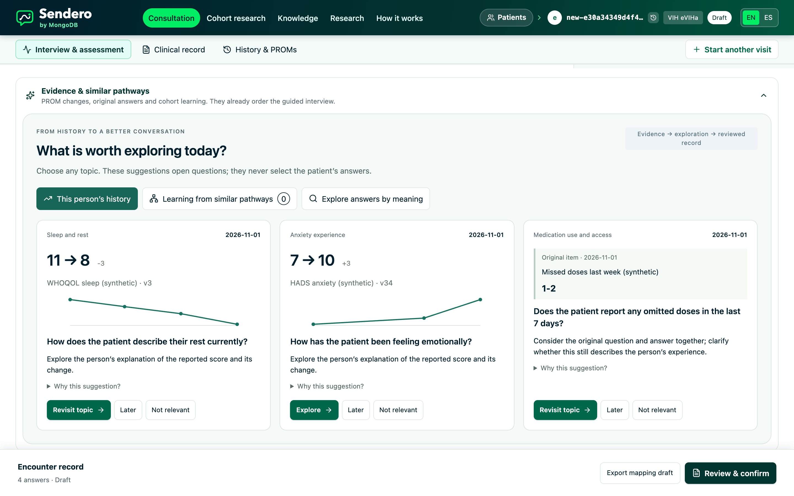

## Represent missing hospital context explicitly

The hospital history view is empty in this capture. It does not demonstrate a live connection to medication, admission or laboratory systems.

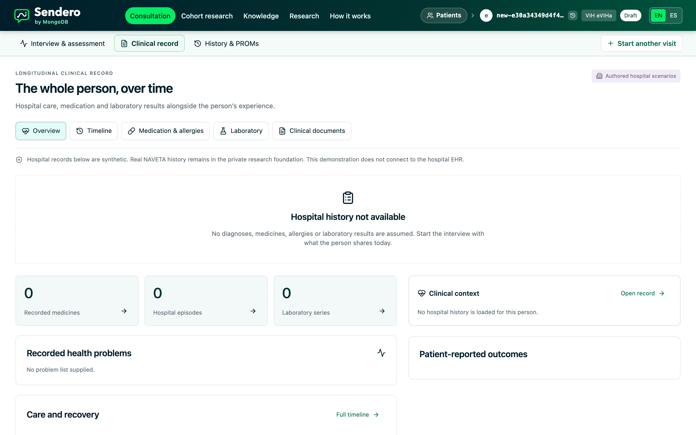

## Browse the concept hierarchy

The layered graph displays general-to-specific paths and multiple inheritance in the authored assessment taxonomy. It is not a complete medical terminology.

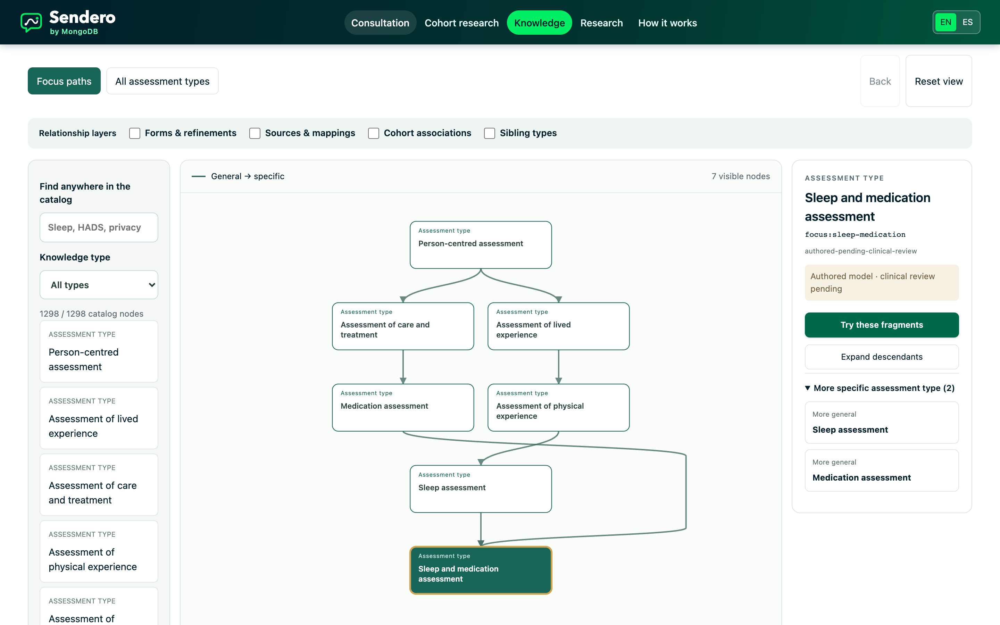

## Inspect a selected concept

The inspector connects an assessment type to its parents, children and reusable fragments.

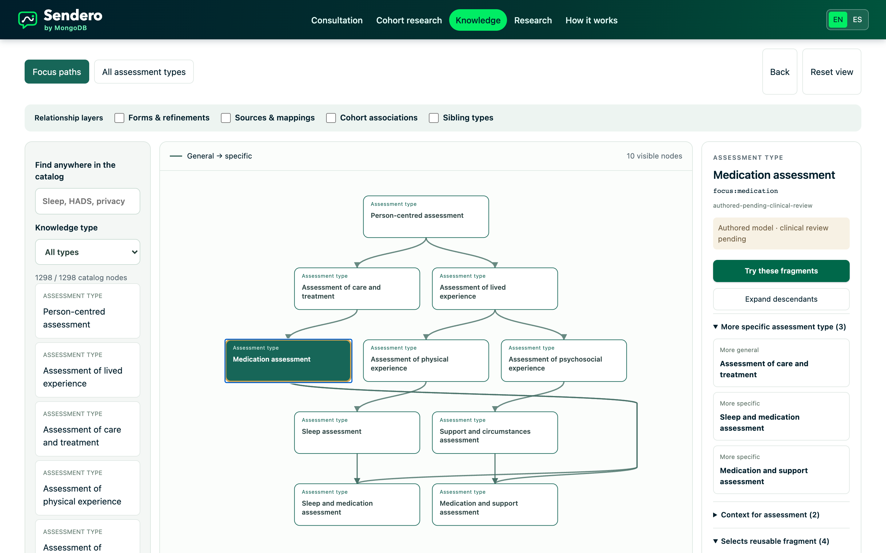

## Separate hierarchy from mappings

Optional layers expose fragments and source or record bindings. These relations are distinct from subtype relationships.

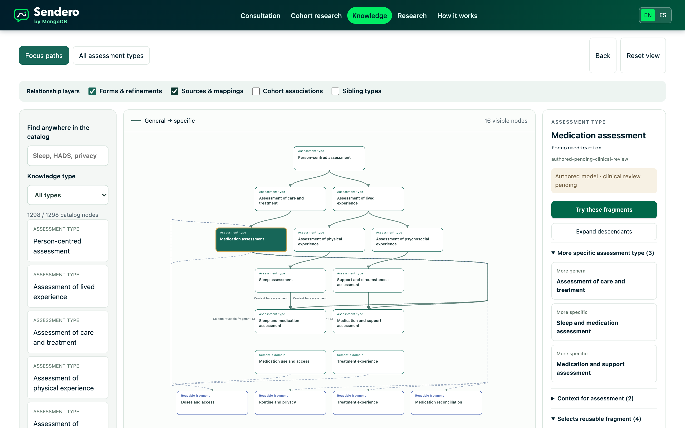

## Search candidate evidence

The evidence-search controls are shown before results. This capture uses the local words-and-concepts mode and does not itself demonstrate Atlas/Voyage retrieval.

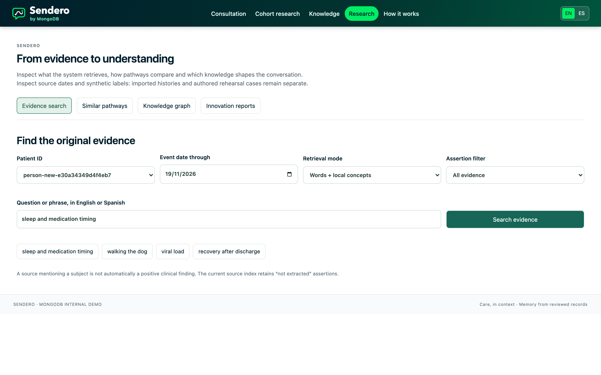

## Show a no-match result honestly

The pathway view reports zero eligible matches in the displayed comparison. It demonstrates the no-match state, not a successful discovery or a clinical outcome prediction.

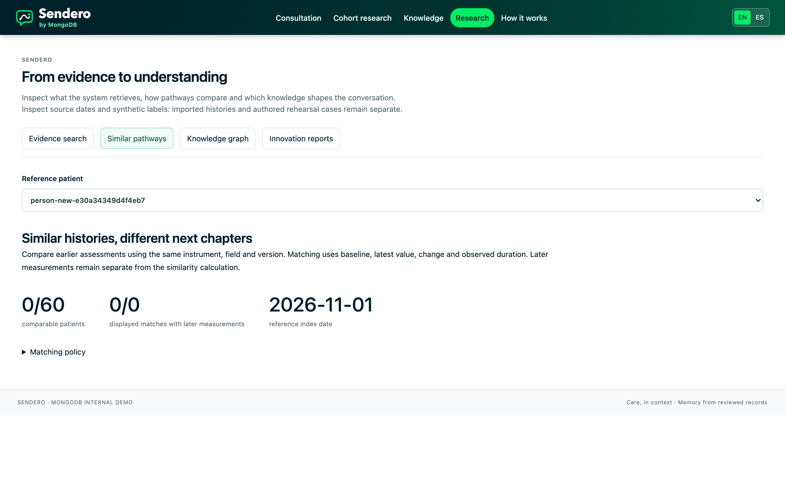
