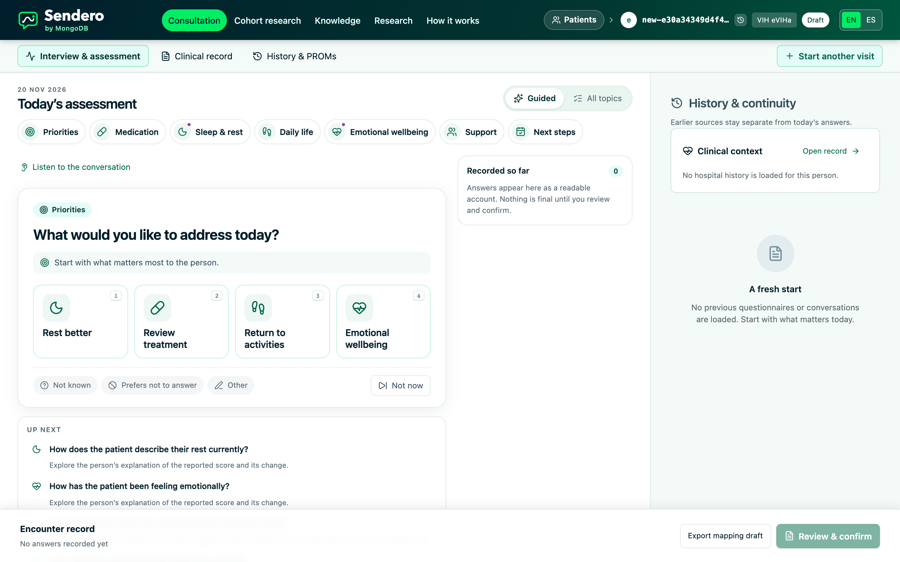
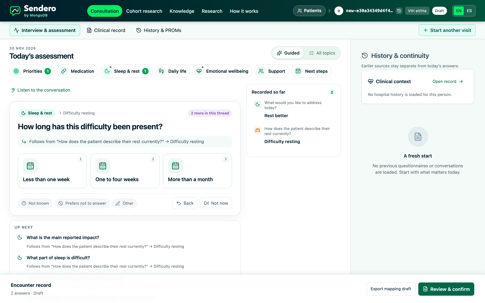
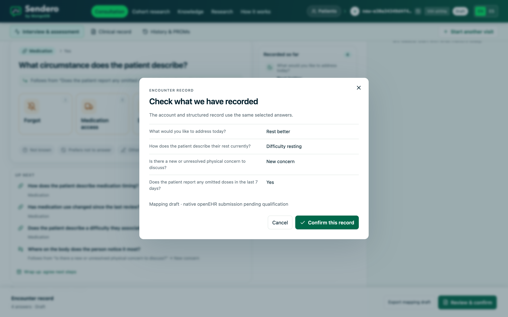
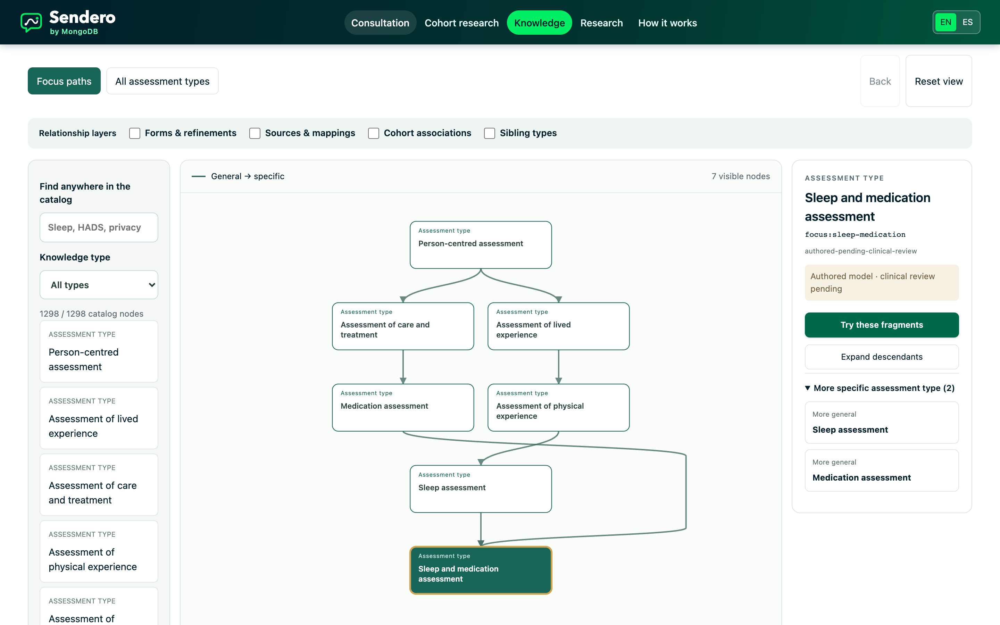
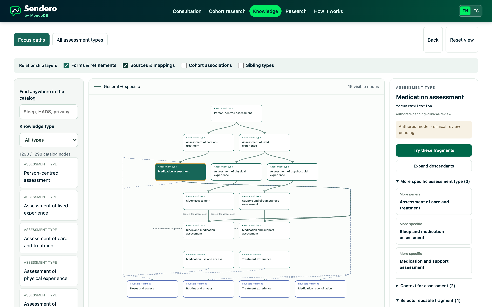

# Sendero: from clinical meaning to a confirmed record

**PEN&PAD revival bonus track · Nordic openEHR Hackathon 2026**

**Contributor:** Francesc Mateu, Field CTO, Healthcare, MongoDB

**Contact:** [francesc.mateu@mongodb.com](mailto:francesc.mateu@mongodb.com) · [GitHub: Paco-Mateu](https://github.com/Paco-Mateu)

Sendero explores a contemporary PEN&PAD-style interaction: **target a clinical concern, refine its meaning through appropriate choices, and confirm a readable account before recording it**. Its clinical setting is a pharmacist's conversation with a person living with HIV, informed by patient-reported outcome measures (PROMs), previous conversations and follow-up assessments.

The contribution is a working research prototype and a documented bridge between a concept model, reusable assessment fragments and openEHR information structures. It is motivated by the NAVETA/Visionarium project. The interface is branded “Sendero by MongoDB”; this is an experimental prototype, not an officially released MongoDB product.



## The PEN&PAD connection

The [PEN&PAD revival](https://pen-pad-revival.github.io/) and [Clinergy thumb-pain walkthrough](https://pen-pad-revival.github.io/docs/clinergy-thumb-pain-demo/) suggested something more useful than another electronic questionnaire: select an appropriate description, expose meaningful refinements, retain the developing statement, and let the professional decide how far to explore.

| PEN&PAD principle | Sendero implementation |
|---|---|
| Target the concern | Enter through a topic, a physical location, or an item of evidence. A new patient can start without prior history. |
| Select relevant recording structure | Versioned assessment types select reusable question fragments. Combined types inherit fragments from multiple parents, with shared fragments included once. |
| Refine progressively | Answer buttons and “More…” details expose duration, pattern, impact or circumstances as appropriate. The path and existing answers remain visible. |
| Preserve clinical freedom | Guided mode offers a next step; other topics remain available. The pharmacist can change direction, defer a question, or use the broader assessment view. |
| Review the meaning | A readable account is generated from the selected answers. Negative, unknown, declined and unanswered states remain distinct. |
| Confirm before recording | Draft answers are reviewed and confirmed as a versioned snapshot. Candidate mappings are visibly distinguished from qualified clinical records. |

This is an adaptation of the interaction and modelling principles. We did not copy Clinergy assets, OpenGALEN terminology data or the OpenGALEN browser code, and we have not reproduced its formal classifier.

## A short demonstration

1. **Open a person by identifier**, or start a new encounter. Existing evidence belongs to that same person; it is not substituted with another patient's history.
2. **Ask what matters today.** Choose rest, treatment, activities or emotional wellbeing. The pharmacist can move to another topic at any point.
3. **Follow the meaning deeper.** Selecting difficulty sleeping opens relevant details such as duration and impact. A concern about daily routine can lead into medication-taking circumstances without restarting the assessment.
4. **Consult evidence alongside the conversation.** Charts and source cards provide context. An older answer is evidence to discuss, not an answer automatically carried into today's interview.
5. **Correct a statement.** Changing a parent answer removes incompatible descendant answers from the active draft while retaining the change in its trace.
6. **Review and confirm.** Read the accumulated account, correct it, and confirm the intended version. Confirmation of the interview is distinct from certification of its openEHR mapping.
7. **Inspect the model.** Open the ontology browser to see the assessment's ancestor paths, reusable fragments and candidate record bindings.





The screenshots show a demonstration encounter. Evidence cards marked synthetic are authored examples. Some captures deliberately show empty history or no comparable pathways; these are not evidence of a completed hospital integration or a successful cohort match. See the [annotated screenshot gallery](gallery.md).

## Four models, with explicit connections

The ontology is not the patient's record, and a terminology code is not a complete clinical statement.

| Layer | Responsibility |
|---|---|
| **Concept model** | Stable meanings and explicit subtype relationships. The current local assessment taxonomy supports multiple inheritance. |
| **Interaction model** | Reusable fragments, permitted answers, applicability and refinements; labels and summary wording are separate from stable identifiers. |
| **Information model** | openEHR archetypes and templates constrain the structure used to represent clinical information, including subject, time, authorship and values. |
| **Evidence and assistance** | Source material, historical trajectories and retrieval results can suggest something to explore. An association does not become a subtype relationship or a confirmed patient fact. |

The intended recording chain is:

```text
Clinical concern -> applicable fragment -> selected answer + qualifiers
                 -> readable review -> confirmed encounter snapshot
                 -> reviewed mapping -> validated openEHR COMPOSITION
```

The last step is qualified separately. The general interview currently produces mapping drafts; the bounded openEHR example below demonstrates the technical structure and validation path.

## openEHR: concrete technical evidence and its boundary

This submission includes a [synthetic canonical COMPOSITION](technical/openehr-hads.synthetic.json), containing two authored HADS subscale values in an `OBSERVATION`. It uses an event `COMPOSITION`, an observation history and point event, an item tree, and typed `DV_COUNT` values. The template identity, archetype identity, event time, language and composer are explicit.

The example passed:

- The pinned **openEHR RM 1.0.4 JSON schema**, with the root required to be a `COMPOSITION`.
- The prototype's local validator against its registered `hads_v0` operational template.
- Additional bounded checks for the two subscales, their integer ranges, subject, identity and consistent timezone-aware event times.
- A previously executed **MongoDB Atlas write/read-back**, including independent-client equality and validation of the retrieved composition. The packaged example's canonical digest matches that recorded result.

See the [technical note, validation result and round-trip record](technical/readme.md). These are engineering checks on a synthetic example. They do **not** establish clinical approval of the template, full RM invariant conformance, terminology qualification, or interoperability with an external openEHR clinical data repository. Storing canonical JSON in Atlas does not make Atlas an openEHR CDR.

For a complete clinical interview, entry types must follow the meaning of the information: a reported measurement may be an `OBSERVATION`, an assessment an `EVALUATION`, and a plan or performed activity may need `INSTRUCTION` or `ACTION` structures. We do not force every answer into an observation or generate arbitrary templates from conversation.

## An inspectable ontology, inspired by OpenGALEN

The [OpenGALEN browser](https://erik-sundvalls-bots.github.io/opengalen-browser/#concept=Asthma) informed a **layered, general-to-specific graph**. It shows paths through a directed acyclic hierarchy, including multiple parents, rather than arranging concepts in a circle.



Selecting an assessment type exposes its parents, children and fragments. Optional layers show form refinements and source/record mappings with distinct relationship types. For example, a combined sleep-and-medication assessment can reuse both sets of fragments without duplicating a shared question.



This is an explicitly authored local assessment ontology and a searchable knowledge catalogue, not the full SNOMED CT ontology or an OpenGALEN/GRAIL reasoner. SNOMED CT is a candidate terminology foundation; live, edition-specific terminology qualification remains future work. Empirical cohort relationships do not participate in classification.

## What the contemporary extensions add

**Longitudinal context.** PROM item answers, instrument versions, chat and follow-up evidence can be linked by patient identifier and time. The proposed hospital extension adds medication, allergies, laboratory results and episodes; unavailable hospital information is represented by clearly labelled synthetic examples, not invented facts presented as real history.

**Semantic retrieval.** Atlas Search, Voyage embeddings, vector retrieval and reranking have been exercised on a small synthetic, author-judged bilingual reference set. Their role is to find candidate evidence across different wording. Retrieval is not clinical interpretation, and absent-evidence queries still need a qualified abstention policy. The screenshot of search controls alone does not establish retrieval quality.

**Comparable pathways.** The prototype explores aligned prior trajectories, respecting instrument/version and coverage, rather than matching only a single score. Later observations are kept out of the matching inputs. Such comparisons can suggest a topic for discussion; they do not establish treatment effects or predict this patient's answer. The submitted pathway capture shows the explicit no-match state.

**Traceable persistence.** Atlas stores knowledge assets, evidence, encounter drafts, confirmations and decision traces. A separate MongoDB Agent Engine integration is not connected in this submission. Optional heard-answer proposals also require confirmation; click-based entry is the primary demonstration.

## What we would qualify next

The next useful step is a pharmacist-reviewed subset connecting a few assessment fragments to clinically reviewed openEHR templates and current terminology bindings, followed by an external CDR round-trip. For Visionarium, evaluation should measure semantic fidelity, relevant details captured, correction burden, interview time and the usefulness of suggested topics. Improved clinical outcomes have not been demonstrated.

The reusable contribution is the **versioned contract between meaning, available refinements, evidence and a confirmed record**. It can support other clinical settings without treating every workflow as a fixed sequence of screens.

## Submission contents and references

- [Annotated screenshots](gallery.md)
- [Synthetic openEHR example and technical evidence](technical/readme.md)
- [PEN&PAD revival portal](https://pen-pad-revival.github.io/)
- [Clinergy demonstration](https://pen-pad-revival.github.io/docs/clinergy-thumb-pain-demo/)
- [Alan Rector interview, part 4: concepts and archetype-sized fragments](https://pen-pad-revival.github.io/interviews/alan-rector-part-4/)
- [OpenGALEN browser source and documentation](https://github.com/erik-sundvalls-bots/opengalen-browser)

This PR contains the English briefing, screenshots and a synthetic technical example. It does not publish patient-level source exports, credentials, the application's source code, or a publicly hosted live service. Contact the contributor for a walkthrough.
